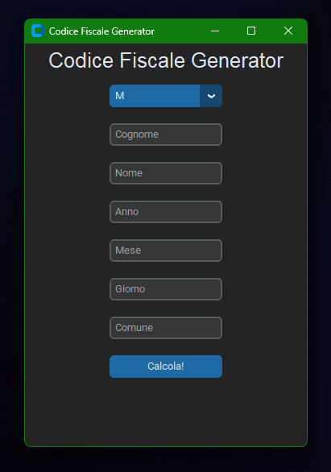

# Generatore di Codice Fiscale

## Descrizione

Progetto incompleto.  
Sin da piccolo dai tempi di Windows XP, un giorno mi ritrovai sul PC un software che permetteva di genererare il tuo codice fiscale inserendo alcuni dei tuoi dati.  
Quando da grande mi tornò questo ricordo, dopo aver messo piede nel mondo del coding, i due pensieri si unirono e nacque la mia esigenza e curiosità nel volerlo ricreare da 0.  
Il progetto purtroppo è ancora incompleto ma al momento è in grado di generare 15 caratteri su 16, non coprendo ancora tutti i casi.
